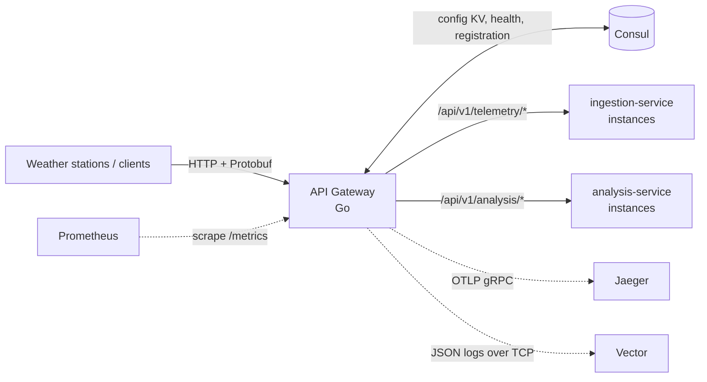

# Eco Platform API Gateway

[](https://github.com/NeoBliz1/eco-platform-api-gateway/actions/workflows/ci.yml)
[](https://go.dev)
[](LICENSE)

A lightweight edge gateway written in Go for the
[Eco Monitoring Platform](https://github.com/NeoBliz1/eco-monitoring-platform).
It is the single entry point for weather-station telemetry and client API calls: it discovers
backend instances in **HashiCorp Consul**, load-balances requests across the healthy ones, and
adds tracing, metrics and structured logging to every hop.

## Features

- **Dynamic service discovery** — routes map URL prefixes to Consul service names. The list of
  healthy instances is refreshed every 10 s, so backends can scale up or down without a restart.
- **Round-robin load balancing** across healthy instances (lock-free counter, `httputil.ReverseProxy`).
- **Centralized configuration** — runtime settings are loaded as YAML from the Consul KV store.
- **Self-registration** — the gateway registers itself in Consul with an HTTP health check and
  detects its own host IP automatically.
- **Request filtering** — route rules are validated at startup; query strings are size-limited and
  checked for SQL-injection, XSS and path-traversal patterns before proxying.
- **Distributed tracing** — OpenTelemetry spans per route, exported over OTLP/gRPC to Jaeger;
  W3C `traceparent` is propagated to backends. Can be switched off in config.
- **Metrics** — Prometheus counters and latency histograms at `/metrics`.
- **Structured logging** — `log/slog` JSON logs, streamed over TCP to Vector (falls back to stdout).

## Architecture



## Endpoints

| Path                 | Description                                                 |
|----------------------|-------------------------------------------------------------|
| `/health`            | Liveness check used by Consul. Returns `{"status":"UP"}`.   |
| `/metrics`           | Prometheus metrics.                                         |
| `<route prefix>/...` | Proxied to a healthy instance of the mapped Consul service. |

Every proxied request gets an `X-Gateway-Route-Target` header naming the target service.

### Metrics

| Metric                                  | Type      | Labels             |
|-----------------------------------------|-----------|--------------------|
| `gateway_http_requests_total`           | counter   | `method`, `status` |
| `gateway_http_request_duration_seconds` | histogram | `method`           |

## Configuration

Configuration is loaded in two steps:

1. **Environment** — `CONSUL_ADDRESS`, the address of the Consul agent. It can be set directly
   or in an optional `.env` file (see `.env.example`).
2. **Consul KV** — the rest of the settings are read as a flat YAML document from the key
   `config/eco-monitoring-gateway/data` (see `gateway-config.example.yaml`):

```yaml
port: "8000"
host: "localhost"                 # fallback if the host IP cannot be detected
routes: "/api/v1/telemetry/:eco-monitoring-ingestion,/api/v1/analysis/:eco-monitoring-analysis"
log_level: "INFO"
logstash_destination: "127.0.0.1:6001"   # Vector TCP source
request_trace_enabled: true
```

`routes` is a comma-separated list of `<path prefix>:<consul service name>` pairs.
Entries with an invalid path or service name are skipped with a warning.

## Getting started

### Prerequisites

- Go 1.26+
- A running Consul agent. The full infrastructure (Consul, Kafka, Jaeger, Vector, backend services)
  is started by the [eco-monitoring-platform](https://github.com/NeoBliz1/eco-monitoring-platform)
  Docker setup.

### Run

```bash
cp .env.example .env               # or export CONSUL_ADDRESS
# put the YAML config into Consul KV
consul kv put config/eco-monitoring-gateway/data @gateway-config.example.yaml
go run .
```

### Build

```bash
go build -o bin/go-service .
```

## Testing

**Unit tests** cover route-rule validation, query filtering and proxying: round-robin balancing,
no healthy instances, rejected queries. They use a fake Consul server, so nothing else needs to be
running. CI runs them on every push.

```bash
go test -race ./pkg/...
```

**End-to-end test:** `test/e2e` contains an end-to-end test of the whole telemetry pipeline: it sends a Protobuf
`WeatherPacket` through the gateway (`POST /api/v1/telemetry/...`) and checks that it arrives in
Kafka (SASL/SCRAM-SHA-512). It needs the full platform running locally.

```bash
go test ./test/e2e/... -v
```

## Project structure

```
.
├── main.go                  # entry point: load config, init logger, start gateway
├── api/gateway.go           # tracing init, Consul registration, HTTP server
├── pkg/
│   ├── config.go            # env (optional .env) + Consul KV YAML loading
│   ├── routes.go            # route table, discovery refresh, proxying, request filtering
│   ├── routes_test.go       # unit tests (fake Consul + test backends)
│   ├── metrics.go           # Prometheus middleware
│   ├── logger.go            # slog JSON logger with Vector TCP output
│   ├── telemetry/otel.go    # OpenTelemetry tracer provider (OTLP/gRPC)
│   ├── proto/               # Protobuf validation rules
│   └── generated/           # generated Protobuf code (weather telemetry)
└── test/e2e/                # end-to-end pipeline test
```

## License

[MIT](LICENSE)
